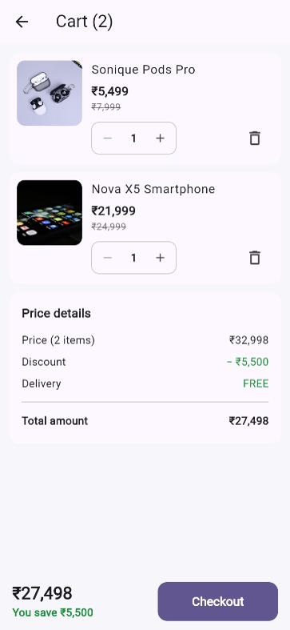
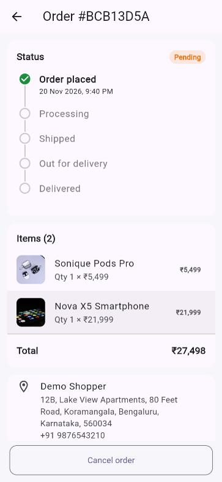

# Cartzy — Flutter Shopping App

A complete shopping app built with Flutter for **Android and the web**, running on a live Node.js + MongoDB backend.

**Try it in your browser:** https://raj02priyesh.github.io/cartzy-shop-app/
**Demo login:** `demo@cartzy.app` / `demo1234` — or tap **Use demo** on the sign-in screen.

> The API runs on a free host that sleeps when idle, so the very first load can take up to a minute.

Backend (REST API): [cartzy-ecommerce-backend](https://github.com/Raj02Priyesh/cartzy-ecommerce-backend)

<p>
  
  
  
  
</p>

## Features

- **Home** — auto-scrolling banner carousel, shop-by-category, best sellers and the full catalog
- **Browse & search** — categories with sub-categories, live search with debouncing, sort by price or discount
- **Product details** — image gallery, MRP / price / % off, stock status, specifications, similar products
- **Accounts** — sign up, sign in (JWT), session restored on restart, automatic sign-out when a session expires
- **Cart** — quantities, live totals and savings, synced with the server
- **Wishlist** — save items with one tap, move to cart
- **Checkout** — saved addresses, add a new address with validation, cash on delivery
- **Orders** — order history, delivery timeline (placed → processing → shipped → out for delivery → delivered), cancel pending orders
- **Polish** — light & dark themes, loading / empty / error states with retry, responsive grid from phones to desktops, a friendly "waking up the server" message on cold starts

## Tech

| | |
|---|---|
| Framework | Flutter 3.47 (Dart 3.13), Material 3 |
| State management | Provider (`ChangeNotifier`) |
| Networking | `http` with a typed API client and user-friendly errors |
| Storage | `shared_preferences` for the session |
| Images | `cached_network_image` |
| Platforms | Android, Web |
| CI/CD | GitHub Actions: analyze → test → build → deploy to GitHub Pages |

## Project structure

```
lib/
  config.dart          API base URL (overridable at build time) and demo login
  core/                API client, formatting helpers
  models/              Product, Category, Cart, Order, Address, User — parsed defensively from JSON
  services/            Catalog and order endpoints
  state/               Auth, cart and wishlist providers
  screens/             One file per screen
  widgets/             Product card, images, prices, empty/error/loading states
test/                  Unit tests for JSON parsing and business rules
```

## Run it

```bash
flutter pub get
flutter run -d chrome          # web
flutter run                    # connected Android device or emulator
```

By default the app talks to the live API. To use a local backend instead:

```bash
flutter run --dart-define=API_BASE_URL=http://10.0.2.2:5000/api    # Android emulator
flutter run -d chrome --dart-define=API_BASE_URL=http://localhost:5000/api
```

Build an Android APK:

```bash
flutter build apk --release
```

## Tests

```bash
flutter analyze
flutter test
```

Both run automatically on every push, and the web app is redeployed when they pass.

## Credits

Product photos are free-licence images from [Unsplash](https://unsplash.com/license). Brands and products are fictional sample data — no real payments are taken.

## License

[MIT](LICENSE) © Priyesh Raj
